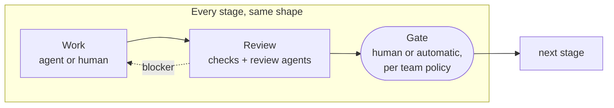
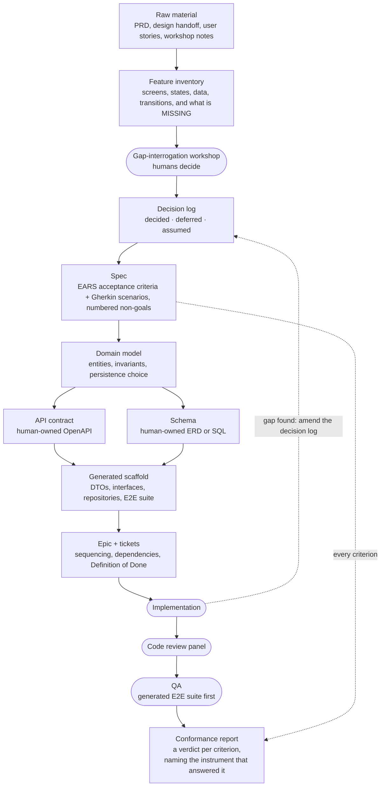

# AI Driven Development: A Manifesto

*A stand on AI-driven code generation and the modern SDLC, and the belief that [AEOS](https://github.com/lycha/aeos) is built to enforce. Adopt it, adapt it, and build a team and a process around it.*

---

## The premise

**AI makes the engineering discipline of the last forty years more valuable.** Domain-driven design, explicit contracts, tests, feature flags and continuous delivery were always good practice, and teams routinely skipped them under pressure. They got away with it because the engineer who wrote the code carried the missing context in their head: why a rule exists, which edge case matters, what the customer actually meant. An agent carries none of that. It sees only what has been written down, so those practices become the *controls* that keep its output correct. A team that skips them still delivers faster, and hides debt faster too.

**Treat an agent like a capable engineer on their first day, every day.** Give it real trust and autonomy inside explicit guardrails, write down everything it needs to know, and keep a human as the final authority over what ships. The boundaries have to be clear enough that a fast, literal-minded contributor with no memory of yesterday cannot get them wrong.

---

## Why this works now

Model-driven development and behaviour-driven development asked for the same thing this manifesto does: write the specification first and generate or verify the code from it. Both depended on human discipline. Under deadline pressure people edited the code directly, skipped updating the models and feature files, and the specification drifted away from the running system.

In an agentic pipeline, the pipeline enforces the discipline. A deterministic orchestrator runs it, and agents are steps inside it. When a check fails, the work always goes back for rework, and after a configurable number of failed attempts it escalates to a human. Everything an agent is judged against (the specification, the contracts, the generated tests and the review rubrics) is defined outside the agent's workspace, so an agent cannot weaken the checks it has to pass. The specification also stays small. It covers the structure (contracts, schemas, invariants and scenarios), and agents write the logic that model-driven tools could never generate.

The size of each specification is a choice made for each piece of work. A team can specify a whole payment service at once, or only its dunning process, and most work should be sliced small. Each slice is deployed continuously, released behind a flag, and measured against its success metric, and what the team learns goes back into the specification as an amendment. The specification is a living artefact that changes as often as the code.

---

## How the work should flow

### People own intent, agents own execution

Humans write the specification, make the architectural calls, and hold the gates that matter most (see [Where humans sign off](#where-humans-sign-off)). Agents execute inside those decisions.

In **AEOS** this is the pipeline itself. Every stage, from product scoping through tech spec, implementation and review to a definition-of-done gate, has the same shape. The stage produces an artefact, reviewers check it against a rubric, and a gate decides whether it moves on:

For code review, the artefact is the diff from implementation and the review panel is its reviewers.

Every artefact is versioned in its own git tree next to the code, so the trail from intent to shipped change can be audited after the fact. AEOS goes one step further: **it commits the agent's own reasoning output to the git repository, and every artefact an agent produces links back to that reasoning log.** The audit trail then records why the agent decided something as well as what changed. You can walk from a shipped line to the artefact, from the artefact to the reasoning that produced it, and from there back to the decision and the source it came from (see [the feature pipeline](#the-feature-pipeline)).

### Humans write the specification, generators write the scaffold, agents write the logic

The specification is the most important engineering artefact, and humans write it. Gherkin scenarios, EARS requirements, actors, UML and ERD diagrams, the OpenAPI contract and the domain invariants are brainstormed and reviewed in detail against product and business needs. The context that decides how software should behave lives with the people who use it and the business that pays for it, and an agent only sees what has been written down.

For code, agents write and humans review. For specification the roles swap: a human drafts, and an agent reviews the draft for gaps, ambiguity and contradictions. Problems are much harder to spot in a draft you didn't write, so when an agent does draft, it only turns decisions already recorded in the decision log into EARS and Gherkin. A decision that isn't in the log can't appear in the spec.

Everything that can be derived from the specification is generated deterministically:

- **API.** DTOs, interfaces, clients and server stubs are generated from the OpenAPI contract.
- **Database.** A human owns the schema, because the schema is what keeps the data consistent. The team defines it in whichever form it prefers, an ERD or SQL, and generates migrations and repository code with the tools it trusts.
- **Domain invariants.** Each invariant, such as `balance == Σ ledger` within one transaction, is enforced by a database constraint or a property test the code cannot bypass.
- **Scenarios.** Gherkin scenarios generate the end-to-end suite. A tool such as playwright-bdd turns every scenario into a Playwright test, and the same feature files always produce the same tests. Step definitions bind each Gherkin phrase to the browser actions behind it.

The generated code forms a framework, and agents fill it with business logic. Models will stay probabilistic, so the less they have to invent, the less room they have to guess.

### Agents work from the system's memory

Decision logs, invariants and Gherkin user stories live alongside the code. Agents are grounded in the codebase and the documentation, so each one reasons from the system's own memory and starts from what the team has already decided. Merges are gated by the review panel and a green static gate, and every change to the API contract or the database schema gets an engineer's review, because those are the two hard contracts that outlive any single change.

### Review is a panel, and each reviewer runs deterministic checks first

Code review on CI is a panel of five reviewers. Each has its own rubric, each can block the merge, and each is grounded in the artefacts the change is supposed to satisfy. Every reviewer works in two layers. Deterministic checks run first and cover everything that can be expressed as a rule. A review agent then covers what the rules cannot express.

| Reviewer | Deterministic layer | Agent layer |
|---|---|---|
| Engineering | lint, typecheck, tests, coverage on changed lines | idioms, error handling, test quality |
| Product | executable Gherkin scenarios and EARS criteria | the tests actually exercise the behaviour the scenarios describe; numbered non-goals are respected; behaviour no scenario covers |
| Invariants | database constraints, property tests | new code paths that could bypass an invariant; changes that imply an invariant nobody has written down |
| Architecture | fitness functions for layering, module boundaries and database ownership | whether the change keeps the intent of each ADR where no rule captures it |
| Security | secret scanning, SAST, dependency audit | authorisation gaps, data exposure, a new endpoint that should have stayed private |

When a review agent keeps catching the same class of problem, that finding becomes a deterministic rule, and the agent's rubric moves on to what remains. A human still signs off, and the panel tells them where to look.

### Where humans sign off

Human attention is the scarcest resource in the pipeline, so it goes where agents are weakest. Three gates always have a human: the specification, any change to the API contract or the database schema, and the release. The specification is where the business context lives, and the two hard contracts outlive any single change. Release is the hardest gate of all, because it is the moment a feature reaches users.

Deployment is a separate step and runs without a human once the safety nets are in place: feature flags, automated rollback, and monitoring detailed enough to trigger that rollback on its own. A deployed change stays invisible to users until someone releases it.

Above that floor, the team or its engineering leadership decides which gates need a human, based on what the organisation needs. A regulated payments team may keep a human on every security review permanently. A team building internal tools may let the panel handle security from day one. The review panel and static checks run in every case, and the decision is only whether a human signs off on top of them.

The agent evaluations inform that decision. A gate can move to the panel alone once humans stop overturning its passes, for example none in the last fifty changes, and it returns to a human as soon as an escaped defect traces back to it.

A human can override a blocking reviewer with a written reason. The override is recorded next to the agent's reasoning log, and a false block counts as evaluation data in the same way as a missed problem.

### Code ships when it is ready

Deployment and release are separate steps, controlled by **feature flags and staged rollouts**. The infrastructure is designed for this: stateless, clustered pods with rolling zero-downtime deploys, private by default, with every feature reaching users through the release gate.

**Work is done when it is rolled out, observable, and its success metric has been measured.**

---

## The feature pipeline

When a change is big enough that people would otherwise argue later about what was agreed, it travels one pipeline, from pinned raw material to a machine-checked claim that what shipped is what was specified. Each stage produces an artefact the next one consumes, and each artefact can be reviewed on its own:

Every stage has a gate. Raw material is pinned and cited, and it stays as it was even when a later decision changes direction. A workshop of humans turns open questions into a decision log, and a proposal nobody answered stays an open question. Every acceptance criterion traces to a decision, and every deferral is a numbered non-goal. Contracts and schemas are human-owned and linted. The build gate is a green `lint · typecheck · test`. Review is the review panel plus the human gates the team has set. The pipeline closes on a conformance report, so *"it shipped"* and *"it was specified"* become the same claim.

Acceptance criteria are checked at two levels, and the conformance report records the verdict. The product reviewer on CI checks a single change against the scenarios it claims to satisfy. QA checks the finished output of the pipeline, whether that is a single task, an epic or a whole feature, against every acceptance criterion and user scenario in scope for that piece of work. Its first layer is the automated end-to-end suite generated from the Gherkin scenarios, so every scenario in scope gets a deterministic pass or fail on each run. The rest of QA covers what the suite cannot reach, such as behaviour no scenario describes. For every criterion, the conformance report records the result and the instrument that produced it, drawing on the evidence from both.

Three rules make the pipeline worth having:

- **Traceability runs both ways.** An acceptance criterion names the decision that produced it, and a decision names the source it came from.
- **A late discovery goes back to the artefact that owns it.** A gap found during implementation means amending the decision log or the spec and coming forward again, so the spec always describes what the code does.
- **The prototype is a reference for layout.** Where the prototype and the spec disagree on behaviour, the spec wins.

### Match the ceremony to the change

The full pipeline is for a change big enough that people would otherwise argue later about what was agreed. Most changes are smaller and start further down the pipeline: a wording fix, a behaviour tweak, a bug. A visual or wording change needs a screenshot, the exact location and the exact new words. A behaviour change needs the behaviour described and the contract checked first. A bug needs a failing test that reproduces it before any fix.

Four rules hold on every track:

1. **Every change goes through a pull request.** If an agent asks permission to commit, the answer is a branch and a PR, and nothing goes straight to `main`.
2. **Checks are green before merge.** Lint, typecheck and tests pass, however small the change looks.
3. **A missing decision stops the work.** An undecided question goes back to the team, and nobody settles it inside a handler.
4. **API-contract and database changes get an engineer review.** Those two are hard contracts that outlive the change.

---

## The Product Engineering Architect

The person who writes the specification is a **Product Engineering Architect**, and as agents take over implementation, this is where an engineer's centre of gravity moves. The role exists because the context that decides how software should behave lives with its users and the business, and someone has to turn it into specifications and boundaries an agent can follow.

A Product Engineering Architect is still an engineer, and owns the blueprint. A civil engineer designs a building, calculates the loads and signs off that it will stand, while construction crews build to the drawings. Here the agents build, and the Product Engineering Architect is accountable for the structure: the scenarios, the contracts, the invariants, the data model, and a system that behaves as specified.

The craft is in the tooling. The Product Engineering Architect models the domain in ERD and UML, defines contracts in OpenAPI, writes requirements in EARS and Gherkin, and maintains the generators, fitness functions, review rubrics and evaluations that turn the blueprint into constraints the agents cannot break. **Domain modelling, contract design, testing and evaluation** move from supporting skills to the main job.

The Product Manager and the Product Engineering Architect meet at the specification. The Product Manager owns the strategy and the big picture, thinks months ahead, and makes sure the business grows in the right direction. For each piece of work, the Product Manager owns the problem, the outcome and the priority: who the user is, what they need, and why it matters now. The Product Engineering Architect owns the precise definition. They write the Gherkin scenarios together. In a small team, one person may hold both roles.

Two practices keep the role honest. Engineers stay close to the customers who use what gets built, and the team runs event storming with the business so everyone shares one vocabulary. Engineering outcomes are stated in the business's terms, such as conversion, volume and retention.

The constraint moves with the role, from writing code to **the quality of specifications and the capacity of the people who review specifications and hard contracts.** That is where management attention belongs.

---

## Junior engineers

The work that used to train junior engineers is the work agents now do fastest: small features, bug fixes and boilerplate. If juniors skip that work, the industry stops producing the senior engineers and Product Engineering Architects this model depends on. Teams that adopt agents without a plan for juniors will run short of seniors within a few years.

Junior engineers are hired and grown deliberately, and the pipeline gives them a path:

1. **Hand-written code first.** For a first stretch, juniors write part of their code by hand, because judging an agent's output depends on knowing how code is built.
2. **Small specifications.** The small-change tracks are the entry point. Juniors write the failing test that reproduces a bug, or describe a behaviour change and check it against the contract.
3. **Review alongside a senior.** Juniors review what the agent produced against the specification they wrote, with a senior engineer who explains what they would have caught.
4. **A growing share of the blueprint.** As their reviews start catching what matters, juniors move from single scenarios to whole features, and then to contracts and data models.

The pipeline also gives juniors a better record to learn from than a codebase alone. The decision logs and the agents' reasoning logs show why every decision was made. Time a senior spends teaching a junior is part of the senior's job, and the team plans for it.

---

## How to measure it

Judge an AI rollout on three groups of numbers, read together.

**Delivery health.** The four DORA metrics, read as two pairs so that speed and stability are never traded off in silence: deployment frequency and lead time for changes for throughput, change failure rate and time to restore service for stability. Because deployment and release are separate steps, lead time is also measured to release, from approved specification to a feature in users' hands. Otherwise fast deployments can hide features waiting behind flags for weeks. Escaped defects, meaning bugs that reached users past every gate, sit alongside the stability pair.

**The constraint.** Specification quality and gate capacity are measured directly:

- how often a decision log or spec is amended after implementation has started,
- how long work waits at each human gate,
- how often humans overturn the review panel, counting both passes that should have failed and blocks that should have passed.

**Cost.** Model spend per released change, and the share of engineering time spent on product work against rework and incidents, taken from how work items are tagged in the tracker. The pipeline should run as cheaply as it can, so each agentic task uses the smallest and cheapest model that is good enough for it. The agent evaluations decide what counts as good enough. A task moves to a cheaper model while its override rate and escaped defects hold steady, and moves back when they rise.

If these numbers do not move, the rollout has not paid for itself.

### Evaluate the agents as well as the output

The delivery metrics show whether the system is healthy. They cannot show why an agent produced what it did. So the team periodically evaluates the agents' recorded reasoning against the end result, using the reasoning logs the pipeline commits alongside each artefact. An agent whose reasoning diverged from what the change needed, a reviewer that passed something a gate should have caught, or a rubric that failed to ask the right question each point to something in the system to improve: **the skills, the agent prompts or the rubric definitions.** The same evaluations decide which gates can run without a human and which tasks can move to a cheaper model.

The agents themselves do not learn between runs. The system around them does, the way a team does, by reviewing decisions against outcomes and closing the loop.

---

## In one line

> Humans write the specification and own the contracts and the release; generators build everything deterministic; agents fill the rest inside guardrails; and work is done when it is rolled out, observed and measured.

---

### Further reading

- **AEOS**, the pipeline that enforces this: [README](https://github.com/lycha/aeos/blob/main/README.md)
