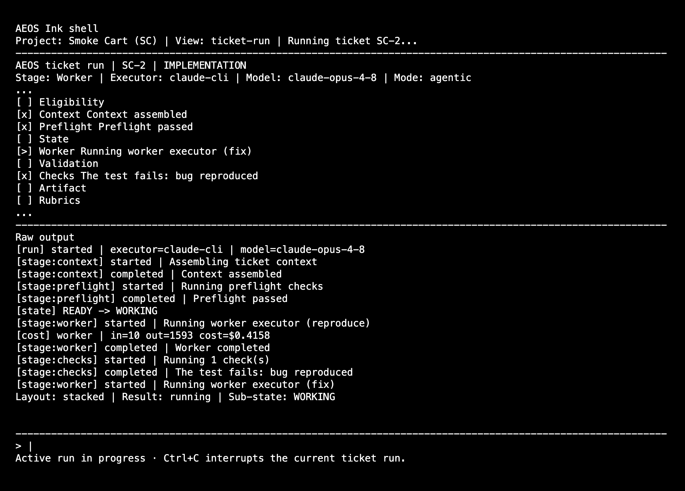
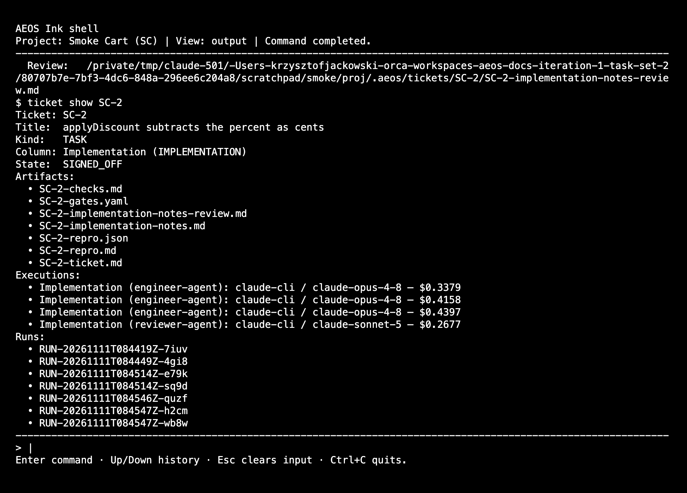
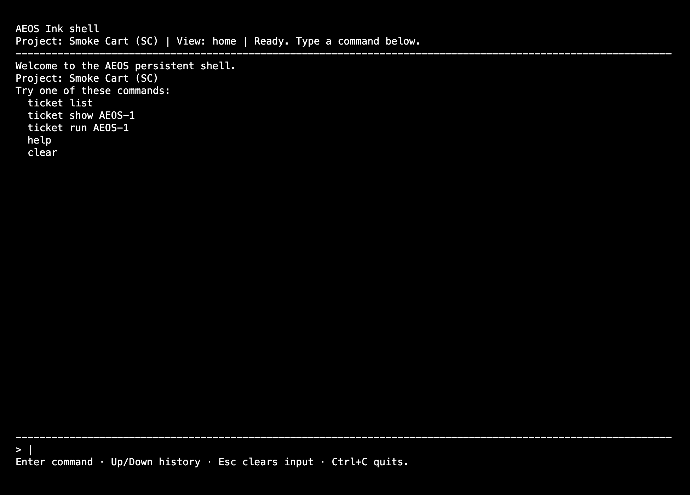
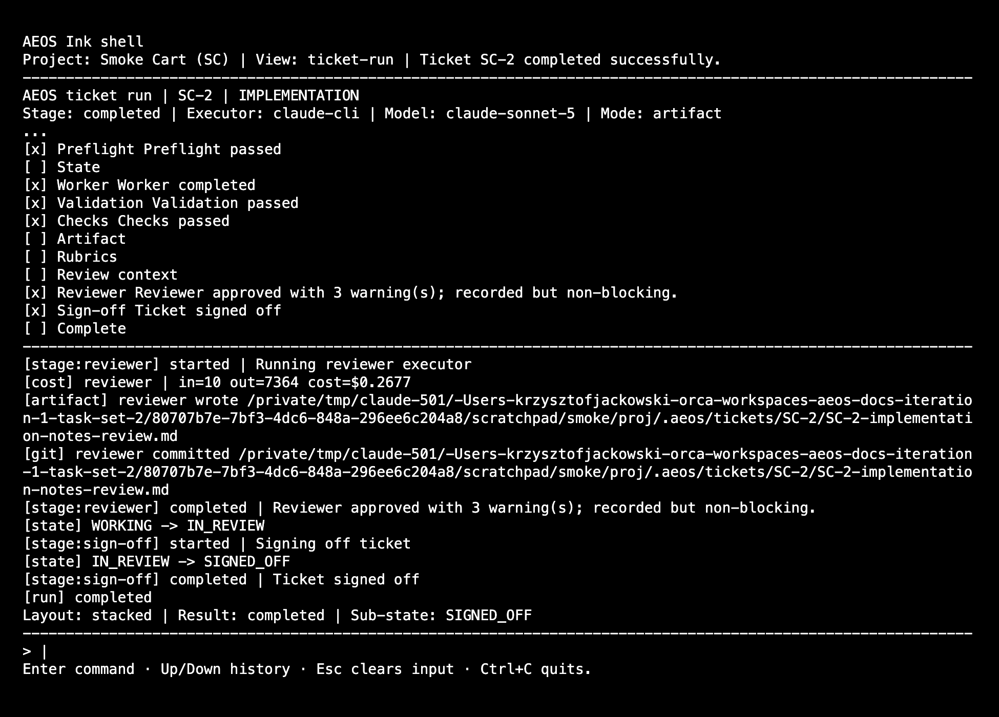

# Operating AEOS: a tutorial

This tutorial walks you through real work with AEOS on one machine, in order: install, a safe dry run, a bug, a feature, and what to do each time the pipeline stops and asks for you.

It is a tutorial, not a reference. The reference is the [README](../README.md); each part below links to the README section that has the full tables. Command output shown here was captured from a run with the stub executor in a project called `Shop` with key `SHOP`; long paths are shortened to `<project>`.

Contents:

1. [What AEOS is](#1-what-aeos-is)
2. [Install and initialise a project](#2-install-and-initialise-a-project)
3. [First run, with the stub executor](#3-first-run-with-the-stub-executor)
4. [A bug, start to finish](#4-a-bug-start-to-finish)
5. [A feature, start to finish](#5-a-feature-start-to-finish)
6. [When it stops](#6-when-it-stops)
7. [Money](#7-money)
8. [The audit trail](#8-the-audit-trail)
9. [Shaping the pipeline](#9-shaping-the-pipeline)
10. [Scripting](#10-scripting)
11. [The interactive shell](#11-the-interactive-shell)
12. [Upgrading an existing project](#12-upgrading-an-existing-project)
13. [Cheat sheet and troubleshooting](#13-cheat-sheet-and-troubleshooting)

---

## 1. What AEOS is

AEOS is a command-line tool that moves a ticket through a fixed sequence of columns. In each column an LLM agent does the work, the project's own checks run, a second agent on a different model reviews the result against rubrics, and then a person decides whether the ticket moves on. You write the specification and make the decisions; agents write the tech spec, the code and the reports. Everything an agent was told and everything a person decided is committed to git, so you can answer "why did this advance?" afterwards. AEOS never merges a pull request and never passes the final gate on its own.

The reasoning behind this split is in the [manifesto](../../AI_MANIFESTO.md) ("People own intent, agents own execution").

### Tickets

There are three things you create:

| You create | With | It is | Pipeline |
| --- | --- | --- | --- |
| An **epic** | `ticket create "<title>" --spec <feature>` | a feature, backed by a spec you wrote | `BACKLOG → SPEC_REVIEW → TECH_SPEC → TASK_BREAKDOWN → INTEGRATION_REVIEW → DOD_GATE → DONE` |
| A **task** | `ticket create "<title>" --parent <epic>` | one piece of an epic | `BACKLOG → IMPLEMENTATION → CODE_REVIEW → QA → DONE` |
| A **bug** | `ticket create "<title>" --bug` | a standalone task with no epic and no spec | the task pipeline, with a reproduce-then-fix rule |

An epic never implements anything. It is specced, broken into tasks, waits in `TASK_BREAKDOWN` until every task is `DONE`, and is then reviewed as a whole.

### Column and sub-state

A ticket's state is two values: the **column** it is in, and a **sub-state** that says what is happening there.

| Sub-state | Meaning | Your move |
| --- | --- | --- |
| `READY` | waiting to be run | `aeos ticket run <id>` |
| `WORKING` | the worker agent is running | wait |
| `IN_REVIEW` | the reviewer is running | wait |
| `SIGNED_OFF` | passed review; waiting for you | read the artifact, then `aeos ticket approve <id>` |
| `BLOCKED` | the agent has questions before it starts | answer them, `aeos ticket answer <id>` |
| `ESCALATED` | the pipeline worked and needs a decision | decide, `aeos ticket resolve <id>` |
| `FAILED` | something broke | read the error, fix the cause, `aeos ticket ready <id>` |

There is also `INTERRUPTED` (you pressed Ctrl+C during a run). `BACKLOG` and `DONE` have no sub-state.

**Escalation is not failure.** `ESCALATED` means the machinery did its job and reached a point only a person can settle: the reviewer rejected the work too many times, attempts stopped converging, a criterion has no owner. `FAILED` means something is broken: an executor crashed, an agent edited a file it must not touch. The two get different exit codes (3 and 1) so scripts can tell them apart.

### One column, one cycle

`aeos ticket run <id>` runs the ticket's current column once:

```
preflight → worker → validation → checks → reviewer → SIGNED_OFF → (you) approve
   │                                 │         │
   └ questions? BLOCKED              └ red? ───┴ rejected? back to the worker, up to the cap, then ESCALATED
```

Then you approve, and the ticket moves to the next column as `READY`. The whole of operating AEOS is that loop, plus knowing what to do at each stop. Full detail: [How It Works](../README.md#how-it-works) and [Ticket State Machine](../README.md#ticket-state-machine).

---

## 2. Install and initialise a project

### Prerequisites

- Node.js 22 or later, macOS or Linux.
- At least one executor CLI on your `PATH`: `claude`, `auggie`, `opencode` or `ollama`. `claude` is the default and the only real executor that reports cost (see [Money](#7-money)). `ollama` cannot do `IMPLEMENTATION`.
- `gh`, authenticated, and a git remote, for the pull requests AEOS opens. Not needed if you turn pull requests off (below).
- Python 3 with two modules, needed only when you create an epic from a spec or repin one:

  ```bash
  python3 -m pip install PyYAML jsonschema
  ```

- A git identity in the project repository (`user.name` and `user.email`). Every decision you make is recorded under it, and commands that record a decision are refused without one.

### Install

```bash
git clone https://github.com/lycha/aeos.git
cd aeos/aeos-core
npm install
npm run build
npm link

aeos install
```

```
✓ AEOS installed. Run 'aeos project init' in your project.
```

`aeos install` creates the AEOS home, `~/.aeos` (override with `AEOS_HOME`). It holds `config.json`, `registry.json` and, from the first command that needs it, `state.db`: one SQLite database for the tickets, transitions and costs of every project on the machine.

`config.json` starts as:

```json
{
  "model": "claude-opus-4-8",
  "currency": "USD",
  "advanceMode": "manual",
  "reviewLoop": { "enabled": true, "maxIterations": 5 }
}
```

In the dry run for this tutorial, `aeos install` also set git's global `core.excludesfile` to `~/.gitignore_global` and put `.aeos/` in it. That is how `.aeos/` stays out of your code repository without a line in the project's `.gitignore`.

### Initialise a project

Run this in the root of a git repository that has at least one commit:

```bash
cd ~/code/shop
aeos project init --name "Shop" --key SHOP
```

```
✓ Project 'Shop' initialised. Key: SHOP.
  Scaffolded 39 file(s) into .aeos/ — column specs, agents, rubrics, and the aeos skill.
  Run 'aeos ticket create <title>' to add your first ticket.
```

The key is 2 to 4 uppercase letters and becomes the ticket prefix: `SHOP-1`, `SHOP-2`.

You now have:

```
.aeos/
├── project.json      identity and configuration (below)
├── CONSTRAINTS.md    your architecture, style and security rules; given to every agent
├── pipelines.yaml    the column order of each ticket kind
├── column-specs/     one YAML per column
├── agents/           worker and reviewer prompts, default executor and model
├── rubrics/          what reviewers judge against
├── schemas/          artefact schemas and lint_decisions.py (do not edit)
├── skills/           the aeos skill, for skill-aware executors
├── features/         one directory per feature: the spec you write
├── contexts/         one directory per bounded context: glossary, constraints
└── tickets/          created with the first ticket: artifacts, gate records, run records
```

Two things to understand about `.aeos/`:

- **It is its own git repository**, ignored by your code repository. Specs, artifacts, reviews and decisions get their own history there. The first commit is `[SHOP][INIT] scaffold`. It has no remote unless you add one.
- **Everything in `column-specs/`, `agents/` and `rubrics/` is yours to edit.** Commit your edits in `.aeos` before running anything (the reason is under [protected paths](#failed-protected-path-violation)).

`project init` also adds `.claude/skills/aeos` and `.augment/skills/aeos` links to your code repository. They show as untracked files. Commit them or ignore them; if you leave them, the first `IMPLEMENTATION` run commits them on the ticket's branch as `[<id>][BASELINE] pre-existing changes before IMPLEMENTATION`.

If it stops here:

- *git refuses the commit (no identity).* The message says how to set one. Set it and run `aeos project init` again; re-running is the repair path and never overwrites a file you edited.
- *Exit 4, resource `aeos_home`.* You have not run `aeos install`.

Open `.aeos/CONSTRAINTS.md` now and write down the rules an agent must follow in this codebase. It is a placeholder until you do.

### What `project.json` can configure

`project init` writes only the identity. Everything else is optional and you add it by hand. A filled-in example:

```json
{
  "id": "shop",
  "name": "Shop",
  "key": "SHOP",
  "path": "/Users/you/code/shop",
  "created_at": "2026-11-11T07:46:45.069Z",

  "executor": { "type": "claude-cli", "model": "claude-opus-4-8" },

  "checks": [
    { "name": "typecheck", "command": "npm run typecheck", "timeoutSeconds": 120 },
    { "name": "lint", "command": "npm run lint", "timeoutSeconds": 120 },
    { "name": "test", "command": "npm test", "timeoutSeconds": 600 }
  ],

  "protectedPaths": ["db/migrations/**"],

  "pullRequests": { "enabled": true },

  "criteria": {
    "testGlobs": ["src/**/*.test.ts", "src/**/*.test.tsx", "tests/**/*"],
    "testReport": {
      "command": "npx vitest run --reporter=json --outputFile=.aeos/tmp/test-report.json",
      "path": ".aeos/tmp/test-report.json",
      "format": "vitest-json"
    }
  },

  "generators": [
    { "name": "api", "command": "npm run generate:api",
      "inputs": ["api/openapi.yaml"], "outputs": ["src/api/generated/**"] }
  ],
  "contracts": ["src/db/schema.ts"],

  "labels": { "BACKLOG": "Inbox", "DONE": "Shipped" }
}
```

| Key | What it does | Detail |
| --- | --- | --- |
| `executor` | Default executor and model for every agent in this project | [Executors](../README.md#executors) |
| `checks` | Your own commands, run before any reviewer on columns with `runChecks: true` (`IMPLEMENTATION`, `INTEGRATION_REVIEW`). In order, stop at the first failure. Put the fastest first | [Checks](../README.md#checks) |
| `protectedPaths` | Extra paths no agent may change. Adds to the built-in list; cannot remove from it | [Protected paths](../README.md#protected-paths) |
| `pullRequests` | `{ "enabled": false }` skips the push and the pull request. Branches and commit trailers stay | [Branches and pull requests](../README.md#branches-and-pull-requests) |
| `criteria.testGlobs` | Which files count as tests when acceptance criteria are traced. The list above is the default | [Criterion tracing](../README.md#criterion-tracing) |
| `criteria.testReport` | How to get test results for the conformance report. `vitest-json` is the only format read. Without it every criterion starts `unverified` | [Conformance report](../README.md#conformance-report) |
| `generators` | Commands run before an agentic worker when their inputs changed; their outputs become protected | [Generators and the contract gate](../README.md#generators-and-the-contract-gate) |
| `contracts` | Paths whose change a person must approve explicitly | same |
| `labels` | Display names for `BACKLOG` and `DONE` | [Column names](../README.md#column-names) |
| `artefactTree` | Keep the artefact tree somewhere other than `.aeos`, as a path relative to the project root | [What `project init` creates](../README.md#what-project-init-creates) |

Set up `checks` before your first real run. Without them a reviewer agent is the only thing between a worker and a sign-off.

Commit the change:

```bash
git -C .aeos commit -am "configure checks"
```

---

## 3. First run, with the stub executor

Before spending money, learn the motions with the stub. `AEOS_EXECUTOR=stub` replaces every agent with an offline stand-in: it clears preflight, writes placeholder artifacts, approves as a reviewer, pushes nothing and calls no `gh`. Nothing is spent.

Do it in a throwaway directory with its own AEOS home, so no practice ticket lands in your real database:

```bash
export SANDBOX=$(mktemp -d)
export AEOS_HOME=$SANDBOX/aeos-home
export AEOS_EXECUTOR=stub

mkdir $SANDBOX/shop && cd $SANDBOX/shop
git init -q
git config user.name "Your Name" && git config user.email you@example.com
echo "# shop" > README.md && git add . && git commit -qm initial

aeos install
aeos project init --name "Shop" --key SHOP
```

`aeos install` writes your global git configuration (the `core.excludesfile` described above). If you want the sandbox to leave even that alone, also `export HOME=$SANDBOX/home GIT_CONFIG_GLOBAL=$SANDBOX/home/.gitconfig` after `mkdir $SANDBOX/home`; that is what the project's own end-to-end tests do.

Now create a ticket and try to run it:

```bash
aeos ticket create "Greeting crashes for a visitor with no name" --bug
aeos ticket list
aeos ticket run SHOP-1
```

```
✓ Created TASK SHOP-1: "Greeting crashes for a visitor with no name"

ID        TITLE                           COLUMN              SUB-STATE
SHOP-1    Greeting crashes for a visitor …Backlog             —

Running ticket SHOP-1…
✗ Ticket SHOP-1 failed: Ticket SHOP-1 is in Backlog. Run 'aeos ticket approve SHOP-1' to advance to Implementation first.
```

First lesson: a ticket in `BACKLOG` cannot be run. Approving it out of `BACKLOG` is your decision to start. (The message names `SPEC_REVIEW` even for a task; the task goes to `IMPLEMENTATION`.)

```bash
aeos ticket approve SHOP-1
aeos ticket run SHOP-1
```

```
✓ Ticket SHOP-1 advanced: Backlog → Implementation (sub-state: READY)

Running ticket SHOP-1…
[run] started | SHOP-1 | Implementation | executor=stub | model=claude-opus-4-8
[stage:context] started | Assembling ticket context
[stage:context] completed | Context assembled
[stage:preflight] started | Running preflight checks | agent=engineer-agent
[preflight/stdout] NO_BLOCKERS
[stage:preflight] completed | Preflight passed
[state] READY -> WORKING
[stage:worker] started | Running worker executor (reproduce) | agent=engineer-agent
...
[stage:checks] completed | The test fails: bug reproduced
[stage:worker] started | Running worker executor (fix) | agent=engineer-agent
...
[stage:checks] completed | The test passes: bug fixed
[git] worker committed <project>/.aeos/tickets/SHOP-1/SHOP-1-implementation-notes.md
[stage:reviewer] started | Running reviewer executor | agent=reviewer-agent
...
[stage:reviewer] completed | Reviewer approved with no findings.
[state] WORKING -> IN_REVIEW
[stage:sign-off] started | Signing off ticket
[state] IN_REVIEW -> SIGNED_OFF
[run] completed
✓ Ticket SHOP-1 reached SIGNED_OFF
  Artifact: <project>/.aeos/tickets/SHOP-1/SHOP-1-implementation-notes.md
  Review:   <project>/.aeos/tickets/SHOP-1/SHOP-1-implementation-notes-review.md
```

That is the shape of every run: stage lines, state changes, the agents' raw output prefixed `[worker/stdout]` or `[reviewer/stdout]`, and a final line with the two files you should read. (At a terminal the same information is drawn as a live view; the lines above are what you get when output is piped.)

Finish the ticket. Each `approve` is a gate you pass:

```bash
aeos ticket approve SHOP-1 && aeos ticket run SHOP-1     # code review
aeos ticket approve SHOP-1 && aeos ticket run SHOP-1     # QA
aeos ticket approve SHOP-1                               # → Done
aeos ticket show SHOP-1
```

```
✓ Ticket SHOP-1 advanced: Implementation → Code review (sub-state: READY)
✓ Ticket SHOP-1 advanced: Code review → QA (sub-state: READY)
✓ Ticket SHOP-1 advanced: QA → Done

Ticket: SHOP-1
Title:  Greeting crashes for a visitor with no name
Kind:   TASK
Column: Done (DONE)
State:  —
PR:     https://stub.invalid/pull/aeos/SHOP-1
```

Look at what it left behind, because the real thing leaves the same:

```bash
git branch                       # aeos/SHOP-1 exists; the default branch is untouched
git log --oneline aeos/SHOP-1    # [REPRO] commit, then the task commit
ls .aeos/tickets/SHOP-1          # artifacts, reviews, SHOP-1-gates.yaml, runs/
git -C .aeos log --oneline       # one commit per artifact, review, run and gate
```

What the stub cannot teach you:

- **A feature task fails at `IMPLEMENTATION`.** The stub writes no code, and an agentic implementation must leave a real diff, so the run ends `FAILED` with `Agentic implementation produced no repository changes`. Only the bug track works under the stub, because the stub plays both of its phases. To practise the feature flow in part 5 under the stub, write a change yourself and use `ticket sign-off --reason` for that one column.
- **Nothing ever blocks, escalates or is rejected.** The stub always answers `NO_BLOCKERS` and `APPROVED`.
- **Task breakdown creates no tasks.** A real architect agent calls `aeos ticket create --parent` itself; the stub cannot.

When you are done, `unset AEOS_EXECUTOR AEOS_HOME` and delete the sandbox.

---

## 4. A bug, start to finish

Goal: a pull request that contains a failing test that reproduces the bug, then the fix, with proof the fix did not weaken the test.

Work from now on is in your real project, with a real executor and no `AEOS_EXECUTOR`.

### Create it

Write the bug down properly first. The description is what the agent works from.

```bash
cat > /tmp/bug.md <<'EOF'
Calling GET /greeting with no saved name returns 500.
Expected: 200 with "Hello, there".
Steps: start the app, clear the session, open /greeting.
EOF

aeos ticket create "Greeting crashes for a visitor with no name" --bug --body-file /tmp/bug.md
```

```
✓ Created TASK SHOP-1: "Greeting crashes for a visitor with no name"
```

You can also edit `.aeos/tickets/SHOP-1/SHOP-1-ticket.md` afterwards; fill in the Description and Definition of Done sections. `--bug` cannot be combined with `--parent` or `--spec`.

### Start it

Commit or stash your own uncommitted work first. The run switches to a new branch, `aeos/SHOP-1`, cut from the local tip of your default branch; if uncommitted changes prevent the switch, the run fails with git's reason.

```bash
aeos ticket approve SHOP-1
aeos ticket run SHOP-1
```



*Screenshots in this tutorial come from a real run on the `claude` executor against a small sample project, "Smoke Cart" (key `SC`), so the ticket ids read `SC-1` and `SC-2` where the text says `SHOP-1`.*

The picture is the interactive shell (part 11) partway through this column: preflight passed, the reproducing test failed as it must ("bug reproduced"), and the worker is now on the fix. Run from a plain terminal, `aeos ticket run` prints the same events as the lines shown under "Raw output".

### What happens in `IMPLEMENTATION`

The worker runs twice inside one attempt.

1. **Reproduce.** The agent adds a failing test and nothing else, and ends its notes with the command that runs it:

   ```
   <!-- AEOS-REPRO
   command: npx vitest run src/greeting.test.ts -t "greets a visitor with no saved name"
   -->
   ```

   AEOS runs that command and requires a non-zero exit. Then it records a hash of every file the phase touched and commits them to your repository as `[SHOP-1][REPRO] …`.

2. **Fix.** The agent is told the command and the files it must not edit. Afterwards AEOS compares the hashes, then runs the same command and requires exit zero.

Then your `checks` run, then the reviewer.

If it stops here:

- *The test passes in the reproduce phase.* It does not reproduce the bug. The attempt is rejected with that feedback and the phase is retried, up to the column's cap (3 in the template).
- *`ESCALATED`, reason `UNPARSEABLE_REPRO`.* The agent's notes had no `AEOS-REPRO` block, or more than one. See [ESCALATED](#escalated-a-decision-is-needed).
- *`FAILED`, "The reproducing test was modified".* The fix edited the test. The file is restored. Run again (`aeos ticket ready SHOP-1`, then `run`); a bug is reproduced only once, so the next run is the fix alone.
- *`ESCALATED`, reason `CONTRACT_CHANGE`.* The fix touched a path listed in `contracts`: it is a behaviour change, not a bug fix. See [the contract gate](#the-contract-gate).

### Read the evidence, then approve

```bash
aeos ticket show SHOP-1
cat .aeos/tickets/SHOP-1/SHOP-1-repro.md
```

```
# Reproduction

Command: `node stub-repro-SHOP-1.cjs`

| Run | Exit code |
| --- | --- |
| Before the fix | 1 |
| After the fix | 0 |
```

Below the table are the two output tails. Read `SHOP-1-implementation-notes.md` and `SHOP-1-implementation-notes-review.md` as well, and look at the diff on the branch:

```bash
git log --oneline aeos/SHOP-1
git diff aeos-base/SHOP-1..aeos/SHOP-1
```



`aeos-base/SHOP-1` is a tag AEOS put on the commit the branch started from. When you are satisfied:

```bash
aeos ticket approve SHOP-1          # → Code review
```

Approval is also what turns the task's working-tree changes into its commit on the branch, `[SHOP-1] <title>` with a `Ticket: SHOP-1` trailer.

### Code review and QA

```bash
aeos ticket run SHOP-1              # code-review.md, and the review of it
aeos ticket approve SHOP-1          # → QA
aeos ticket run SHOP-1              # qa-report.md, and the review of it
```

Each produces an artifact and a review of that artifact in `.aeos/tickets/SHOP-1/`. Read both each time. In `CODE_REVIEW` an agent reviews the task's diff; the reviewer then grades that review against the structure and drift rubrics.

### The pull request

The last approval, out of `QA`, is the one that opens the pull request:

```bash
aeos ticket approve SHOP-1
```

Before the ticket moves to `DONE`, AEOS pushes `aeos/SHOP-1` to `origin` and runs `gh pr create` against the default branch. The body carries the ticket, the code review's path and verdict, the checks table, the reproduction (red, then green) and the total recorded cost. The URL is stored:

```bash
aeos ticket show SHOP-1 | grep PR:
```

For scale: the sample bug behind the screenshots went from `BACKLOG` to `DONE` in ten executor calls across the three columns and `aeos costs` reported $3.35 for it (implementation $1.38, code review $1.01, QA $0.96). Each column was signed off on its first attempt; a rejected review adds calls.

If it stops here: *the pull request cannot be opened* (`gh` missing or not authenticated, no remote, the host refuses). `approve` prints the cause and the fix, exits non-zero, and the ticket stays `SIGNED_OFF`. Fix the cause and run `aeos ticket approve SHOP-1` again; it retries.

**Merging is yours.** Review the pull request as you would any other and merge it yourself. AEOS has no command that merges.

---

## 5. A feature, start to finish

Goal: an epic built from a spec you wrote, implemented by child tasks, reviewed as a whole, and released by you with a verdict per acceptance criterion in front of you.

### 5.1 Write the spec

An epic cannot be created without a spec. A feature's spec is a directory in the artefact tree:

```
.aeos/features/greeting/
├── feature-inventory.yaml    what the sources describe, and what they leave out (absences)
├── decisions.yaml            what you decided about each absence and conflict
├── spec.md                   the acceptance criteria, as bold ids: **AC-1**, **AC-2**
└── features/
    └── greeting.feature      Gherkin scenarios, tagged @AC-1
```

The skills in `plugins/artefact-tree-pipeline/` (a Claude Code plugin; see its [README](../../plugins/artefact-tree-pipeline/README.md) for installing it) produce these in order. They transcribe; they do not decide for you.

| Step | Skill | Produces |
| --- | --- | --- |
| 1 | `prototype-harvest` | `feature-inventory.yaml` from a PRD, stories, a prototype, existing code |
| 2 | `gap-interrogation-solo` (working alone) or `gap-interrogation-capture` (you held a real workshop and have notes) | `decisions.yaml` |
| 3 | `spec-writer` | `spec.md` and the `.feature` files |

`artefact-tree-init` is not needed in an AEOS project: `project init` already seeded the schemas.

The smallest valid feature, taken from the project's end-to-end fixture, looks like this. `spec.md`:

```markdown
---
feature: greeting
context: sample
---

# Sample greeting

## Acceptance criteria

- **AC-1** — When a visitor has no saved name, the system shall greet them as "there".

## Non-goals

- **NON-GOAL-1** — Remembering the visitor's name between visits.
```

`decisions.yaml` (each decision points at an absence in the inventory and says which criterion it became):

```yaml
schema_version: 1
meta:
  feature: greeting
  session: '2026-11-10'
  mode: paired-live
  participants: [owner]
  artefact_tree: { repo: sample-aeos, branch: main }
  inventory:
    repo: sample-aeos
    commit: abc1234
    path: features/greeting/feature-inventory.yaml
decisions:
  - absence: ABS-1
    outcome: DECIDED
    resolution: A visitor with no saved name is greeted as "there".
    becomes: AC-1
    decided_by: human
summary:
  stories_ready: [greeting]
  stories_blocked: []
```

`features/greeting.feature`:

```gherkin
Feature: Sample greeting

  @AC-1
  Scenario: A visitor with no saved name
    Given a visitor with no saved name
    When the greeting is shown
    Then it reads "Hello, there"
```

The matching `feature-inventory.yaml` is in `aeos-core/src/e2e/fixtures/feature-sample/`.

Run the decisions lint yourself before asking AEOS to:

```bash
python3 .aeos/schemas/lint_decisions.py .aeos/features/greeting --schemas .aeos/schemas
```

```
clean (0 warning(s))
```

Then commit the feature in the `.aeos` repository. An uncommitted feature is refused.

```bash
git -C .aeos add features/greeting
git -C .aeos commit -m "spec(greeting): first version"
```

### 5.2 Create the epic

```bash
aeos ticket create "Greeting" --spec greeting
```

```
✓ Created EPIC SHOP-2: "Greeting"
  Spec: SHOP-aeos@2568199eaa90fd99b4bf46561f74727acdbd59a7 (features/greeting)
```

The second line is the **spec pin**: the exact commit of `.aeos` the epic is built from. Every prompt for this epic and its tasks reads the spec through git at that commit, never from your working tree. Editing the spec later does not change what a running epic is told; moving the pin is a deliberate act (`ticket repin`, in part 6).

If it stops here, the checks run in this order and the message names the one that failed:

| Message says | Fix |
| --- | --- |
| `An epic needs a spec: pass --spec <feature>` | You left out `--spec` |
| `Feature "greeting" not found` | The directory, `spec.md` or `decisions.yaml` is missing |
| `The python3 modules PyYAML and jsonschema are needed` (exit 4) | `python3 -m pip install pyyaml jsonschema` |
| schema or lint errors | Fix `decisions.yaml`; run the lint by hand as above |
| an `ESCALATED` outcome | A decision, conflict or question is still escalated. Decide it |
| uncommitted changes | Commit the feature in `.aeos` |

Detail: [Spec-backed epics](../README.md#spec-backed-epics).

### 5.3 Spec review: the spec gate

```bash
aeos ticket approve SHOP-2          # Backlog → Spec review
aeos ticket run SHOP-2
```

`SPEC_REVIEW` does not write requirements. An agent reads your pinned spec and reports gaps, ambiguities, contradictions and untestable criteria in `SHOP-2-spec-review.md`, each finding citing the `AC-n` or decision it concerns.

Read it. This is the cheapest place to find a hole. If the findings are real, fix the spec (see [how answers amend the spec](#blocked-the-agent-has-questions)), or for an epic that has not got far, close it with `ticket move` and create a new one from the corrected spec.

```bash
aeos ticket approve SHOP-2          # recorded as the `spec` gate
```

### 5.4 Tech spec

```bash
aeos ticket run SHOP-2              # the architect writes SHOP-2-tech-spec.md
aeos ticket approve SHOP-2          # → Task breakdown
```

The tech spec is the highest-leverage artifact an agent writes: every task is briefed with it. Read it more carefully than anything else in the epic.

### 5.5 Task breakdown and child tasks

```bash
aeos ticket run SHOP-2              # the architect writes SHOP-2-tasks.md and creates the tasks
aeos ticket show SHOP-2             # lists them under "Tasks"
```

This column is agentic: the architect agent calls `aeos ticket create --parent SHOP-2 --key T-001 --implements AC-1` itself for each task. The reviewer of this column is given the list of criteria no task claims, so a breakdown that leaves a criterion without an owner is rejected here.

If the run produced no tasks, or you want to add or correct one, create it by hand:

```bash
aeos ticket create "Greet a visitor with no saved name" \
  --parent SHOP-2 --key T-001 --implements AC-1
```

```
✓ Created TASK SHOP-4: "Greet a visitor with no saved name" (task of SHOP-2)
```

- `--implements` is the task's claim on acceptance criteria. Every criterion in the spec must be claimed by some task, or the epic stops at integration review.
- `--key` makes creation idempotent. Running the same command again prints `= TASK SHOP-4 already exists … — left as is`. Give every task a distinct key.
- A task has no pin of its own; it uses its epic's.

The epic now waits. Trying to approve it early is refused:

```
Error: Epic SHOP-2 has 1 unfinished task(s): SHOP-4 (Backlog). Finish them before advancing the epic.
```

A task you decide not to build is cleared with `aeos ticket move SHOP-4 DONE --reason "…"`.

### 5.6 Driving: by hand, or with the orchestrator

**By hand**, each task is the loop you already know from the bug, without the reproduce phase:

```bash
aeos ticket approve SHOP-4 && aeos ticket run SHOP-4     # implementation, on branch aeos/SHOP-2
aeos ticket approve SHOP-4 && aeos ticket run SHOP-4     # code review
aeos ticket approve SHOP-4 && aeos ticket run SHOP-4     # QA
aeos ticket approve SHOP-4                               # → Done
```

All tasks of an epic commit to the epic's branch, `aeos/SHOP-2`. Each finished task is one commit:

```
[SHOP-4] Greet a visitor with no saved name

Ticket: SHOP-4
Epic: SHOP-2
Spec: SHOP-aeos@940a80578b79ab6ca942c3a7fd52eb7873e61d45
Implements: AC-1
```

A child task opens no pull request of its own; the epic does.

**With the orchestrator**, AEOS does the running and, where you allow it, the approving:

```bash
aeos orchestrator run SHOP-2 --budget 25
```

It asks a deterministic scheduler "what next?", does that one thing, and asks again, until the epic completes or needs you. Every stop has a name. With the default configuration every column advances manually, so the first thing you see is:

```
✓ SHOP-2 — AWAITING_APPROVAL
  SHOP-2 is ready to leave Backlog, but that column advances manually. Run `aeos ticket approve SHOP-2`.
  0 action(s), $0.00 spent
```

Approve, run the orchestrator again, and it runs the next column and stops at the next gate:

```
[run] started | SHOP-2 | Spec review | executor=stub | model=claude-opus-4-8
[run] completed
  SHOP-2 [Spec review]: run succeeded in 1 attempt(s)

✓ SHOP-2 — AWAITING_APPROVAL
  SHOP-2 is ready to leave Spec review, but that column advances manually. Run `aeos ticket approve SHOP-2`.
  1 action(s), $0.00 spent
```

To let it pass gates on its own, opt in. Globally, in `~/.aeos/config.json`:

```json
{ "advanceMode": "auto" }
```

and keep the gates you care about manual in their column specs, which win over the global setting:

```yaml
# .aeos/column-specs/tech-spec.yaml
advanceMode: manual
```

Every scaffolded column spec says `advanceMode: manual`, so the global setting alone changes nothing: remove or change the line in the columns you want automated. A reasonable first step is `auto` for the task columns (`implementation`, `code-review`, `qa`) and manual for everything on the epic. An automatic advance records no gate, because no person decided.

The halt reasons, and what to do:

| Halt | Exit | Do |
| --- | --- | --- |
| `COMPLETE` | 0 | Nothing. The epic is `DONE` |
| `AWAITING_APPROVAL` | 3 | Read the artifact, `ticket approve`, run the orchestrator again |
| `AWAITING_DECOMPOSITION` | 3 | The breakdown is signed off and no tasks exist. Create them with `--parent` |
| `NEEDS_HUMAN` | 3 | A ticket is blocked, escalated or interrupted, or an approval failed. `orchestrator status`, then part 6 |
| `HUMAN_GATE` | 3 | The epic is at the final gate. `ticket dod-approve` |
| `BUDGET_EXCEEDED` / `COST_UNKNOWN` | 3 | Part 7 |
| `FAILED` | 1 | A ticket failed. Part 6 |

```bash
aeos orchestrator status            # every epic: status, last halt, budget
aeos orchestrator pause SHOP-2      # stop scheduling new work; in-flight runs finish
aeos orchestrator resume SHOP-2     # allow it again; also clears a stale lock
```

```
SHOP-2  IDLE  (budget: $5.00)
  last halt: AWAITING_DECOMPOSITION
  Epic SHOP-2 is decomposed but has no child tasks. Create them from its tasks.md with `aeos ticket create <title> --parent SHOP-2`.
```

Stopping the orchestrator is always safe. A halted epic is a set of tickets in ordinary sub-states that you can drive by hand. Only one orchestrator run drives an epic at a time; a second is refused. Detail: [Orchestrator](../README.md#orchestrator).

### 5.7 Integration review and criterion tracing

When every task is `DONE`:

```bash
aeos ticket approve SHOP-2          # Task breakdown → Integration review
aeos ticket run SHOP-2
```

Before any agent runs, a built-in check traces the pinned spec. Every criterion must be **claimed** by a task and **named** by an instrument: an `@AC-n` tag above a scenario in the `.feature` files, or `AC-n` in a test title or an `@AC-n` comment in a test file matched by `criteria.testGlobs`. For example:

```ts
it('AC-1 greets a visitor with no saved name as there', () => { … });
```

The report is `SHOP-2-criteria-trace.md`:

```
# Criteria trace

Every criterion is claimed by a task and named by a test or a scenario.

- Unclaimed: none
- Untested: none
- Unknown claims: none

| Criterion | Claimed by | Instruments |
| --- | --- | --- |
| AC-1 | SHOP-4 | features/greeting.feature: A visitor with no saved name<br>src/greeting.test.ts: AC-1 greets a visitor with no saved name as there |

Non-goals (listed, not traced): NON-GOAL-1
```

The trace says a test *names* the criterion, not that it passes. Passing is the conformance report's job.

Then your `checks` run on the assembled branch, the integration reviewer reviews the whole `base..HEAD` diff of the epic against the spec and the tech spec, and the standard reviewer grades that report.

If it stops here with `PRE_WORKER_CHECK_FAILED`, a criterion is unclaimed, untested, or a task claims an id the spec does not have. See [part 6](#escalated-pre_worker_check_failed).

Approving out of integration review opens the epic's pull request:

```bash
aeos ticket approve SHOP-2          # → DoD gate; pushes aeos/SHOP-2, runs gh pr create
```

### 5.8 The final gate

`DOD_GATE` is the release decision. It is yours alone; the orchestrator runs the column and then always halts.

```bash
aeos ticket run SHOP-2
cat .aeos/tickets/SHOP-2/SHOP-2-conformance.md
```

The run builds the **conformance report**: one verdict per criterion, from the trace and from your test run (`criteria.testReport`).

```
# Conformance report: greeting

Epic SHOP-2. Spec SHOP-aeos@940a8057…. Code shop@da0218c8….

0 pass, 0 fail, 1 unverified of 1.

| Criterion | Verdict | Instruments | Claimed by |
| --- | --- | --- | --- |
| AC-1 | unverified | — | SHOP-4 |

## To judge

Judge exactly these criteria: AC-1
```

- `pass`: at least one instrument passed and none failed.
- `fail`: any instrument failed. Nothing outvotes a failed test.
- `unverified`: nothing answered. With no `testReport` configured, every criterion starts here.

If every criterion already has a verdict, no agent runs. Otherwise the conformance agent judges exactly the unverified ones against the spec and the diff, and the reviewer checks its reasoning. Its judgements are in `SHOP-2-dod-verification.md`.

Now decide, at a terminal (this command refuses to run without one, and has no `--yes`):

```bash
aeos ticket dod-approve SHOP-2
```

```
── Conformance ────────────────────────────────

1 pass, 0 fail, 0 unverified of 1.

| Criterion | Verdict | Instruments | Claimed by |
| --- | --- | --- | --- |
| AC-1 | pass | agent: conformance-agent (pass) | SHOP-4 |

Pull request: https://github.com/you/shop/pull/12

Approve ticket SHOP-2 as DONE? [y/N] y
✓ Ticket SHOP-2 approved: DOD_GATE → DONE (total cost: $0.0000)
```

The report is rebuilt at this moment, so it describes the commit you are approving. Open the pull request and read the diff before you answer.

Three options change what is recorded:

```bash
# You checked AC-3 and AC-7 yourself. Each gains a `human` instrument naming you.
aeos ticket dod-approve SHOP-2 --verified AC-3,AC-7

# Something is still failed or unverified and you are releasing anyway. The reason is stored.
aeos ticket dod-approve SHOP-2 --reason "AC-5 is covered by the manual smoke test in the release checklist."
```

- With any criterion `fail` or `unverified`, a yes without `--reason` is refused (exit 3).
- `--verified` does not rescue a criterion with a failed instrument; it stays `fail`.
- Answering no records a `rejected` gate with the reason you are asked for, and the epic stays at the gate.

On a yes, `conformance.yaml` and `conformance.md` are committed to `.aeos/features/greeting/` in the same commit as the gate record, the epic becomes `DONE`, and the conformance table is written into the pull request body. If the pull request cannot be updated, the approval stands and a warning is printed.

Then review and **merge the pull request yourself**.

---

## 6. When it stops

Start every time with:

```bash
aeos ticket show <id>
```

It prints the column, the sub-state, and for an escalated ticket the reason, the file to read and the command to run next.

### BLOCKED: the agent has questions

Preflight found something it cannot assume. The questions are in `.aeos/tickets/<id>/<id>-questions.md`:

````markdown
## Q-001
Status: OPEN
Topic: night-greeting
Required: yes

### Question
```text
What greets a visitor at night?
```

### Answer
```text
```
````

Write your answer inside the `### Answer` block of each question, save, then:

```bash
aeos ticket answer SHOP-4
```

It may ask you to confirm (for instance when the file does not look edited); `--yes` answers that in a script.

What happens next depends on the ticket:

- **A bug, or any ticket with no spec:** the ticket is unblocked. `aeos ticket run SHOP-4`.
- **A spec-backed ticket (an epic or one of its tasks):** your answer is a decision the spec did not contain, so it **amends the spec**. AEOS appends it to the feature's `decisions.yaml` as a `DECIDED` entry (`NEW-1`, becoming the next `AC-n`), runs the lint, commits `decide(greeting): amendment from SHOP-4`, and prints:

  ```
  Decision recorded as NEW-1. Update spec.md (spec-writer), commit, then run `aeos ticket repin SHOP-4`.
  ```

  The ticket stays `BLOCKED`, and `ticket run` now refuses **every** ticket pinned to that spec. Finish the amendment:

  ```bash
  # 1. Add the new criterion to spec.md (by hand, or with the spec-writer skill)
  $EDITOR .aeos/features/greeting/spec.md      #  - **AC-2** — When it is night, the system shall …
  # 2. Commit it in .aeos
  git -C .aeos commit -am "spec(greeting): AC-2"
  # 3. Move the pin
  aeos ticket repin SHOP-4
  ```

  ```
  SHOP-2 repinned: 2568199 → 7c1e0aa
  ```

  `repin` re-checks the feature exactly as `--spec` did, moves the epic's pin to the current `.aeos` commit (its tasks follow), and sets the ticket `READY`. Remember that the new criterion needs a task that claims it and a test that names it, or the epic will stop at integration review.

  If it stops here: *`repin` says uncommitted changes* — commit the feature first. *The lint fails during `answer`* — nothing is written; fix `decisions.yaml` and answer again. *A second amendment is refused* — finish the first with `repin`.

### ESCALATED: a decision is needed

`ticket show` gives the reason. The common ones:

| Reason | What happened | Usual decision |
| --- | --- | --- |
| `ITERATIONS_EXHAUSTED` | The reviewer rejected the work up to the cap (`maxIterations`) | Read the last review. Give guidance and resume, or override |
| not converging | An attempt reproduced the previous attempt's blockers, or the same check failed twice in a row | Same. The agent is stuck; tell it what it is missing |
| `UNPARSEABLE_VERDICT` | The reviewer's output had no valid `AEOS-VERDICT` trailer, or the conformance agent's block was malformed | Usually resume and run again |
| `UNPARSEABLE_REPRO` | A bug's reproduce phase had no single `AEOS-REPRO` block | Resume and run again |
| `PRE_WORKER_CHECK_FAILED` | The criterion trace failed | [Below](#escalated-pre_worker_check_failed) |
| `CONTRACT_CHANGE` | A bug's fix touched a contract path | [The contract gate](#the-contract-gate) |
| `SPEC_REQUIRED` | An old epic has no spec | [Upgrading](#12-upgrading-an-existing-project) |

You have three ways out. Pick by what you decided.

**1. Give guidance and let the agent try again: `ticket resolve`.** Open `.aeos/tickets/<id>/<id>-escalation.md`. It says why, and ends with:

````markdown
## Response
<!-- Write your decision below, then run: aeos ticket resolve SHOP-4 -->
<!-- The response is injected into the next run as authoritative operator guidance. -->
```text

```
````

Write your decision in the text block, then:

```bash
aeos ticket resolve SHOP-4
aeos ticket run SHOP-4
```

An empty response is refused: `No response found in SHOP-4-escalation.md. Write your decision in the ## Response block, then re-run.`

**2. Accept the work as it is: `ticket sign-off --reason`.** You read the artifact and the rejected review and you disagree with the reviewer, or you fixed the remainder by hand.

```bash
aeos ticket sign-off SHOP-4 --reason "Reviewer's blocker is a false positive: the rollback path is in src/db/tx.ts."
aeos ticket approve SHOP-4
```

**3. Put the ticket somewhere else: `ticket move --reason`.** Send it back a column, skip a column, or close it.

```bash
aeos ticket move SHOP-4 IMPLEMENTATION --reason "Tech spec changed; rebuild from the start."
aeos ticket move SHOP-9 DONE --reason "Duplicate of SHOP-4; closing without building."
```

The target must be a column of the ticket's own pipeline (identifier or label). Non-terminal targets start `READY`.

Both overrides require a reason of at least ten characters and are recorded as gates (`sign-off-override`, `move-override`) under your name. A sign-off override also records which review verdict it overrode. That is deliberate: an override is fine, an unexplained one is not.

### ESCALATED: `PRE_WORKER_CHECK_FAILED`

```
⏸ Ticket SHOP-2 escalated after 0 attempt(s)
  Reason: PRE_WORKER_CHECK_FAILED
  Check 'criteria-trace' failed before any agent ran. A worker cannot fix this; it needs your decision. Read SHOP-2-criteria-trace.md.
```

```
- Unclaimed: AC-1
- Untested: none
- Unknown claims: none
```

No agent ran and no attempt was used. Fix what the report names:

- **Unclaimed:** create a task with `--parent <epic> --implements AC-1` and drive it to `DONE`, or decide the criterion should not exist and amend the spec.
- **Untested:** add a test whose title contains the id, or tag a scenario.
- **Unknown claim:** a task claims an id the spec does not contain. Correct the `- Implements:` line in that task's ticket document.

Then write what you did in the escalation file's response block, and:

```bash
aeos ticket resolve SHOP-2
aeos ticket run SHOP-2
```

### FAILED: something broke

Read the error in `ticket show`, or the `.log` of the last run in `.aeos/tickets/<id>/runs/`. Fix the cause, then:

```bash
aeos ticket ready SHOP-4
aeos ticket run SHOP-4
```

Causes you will meet:

| Error | Cause | Fix |
| --- | --- | --- |
| `Agentic implementation produced no repository changes` | The worker wrote notes and no code (always, under the stub) | Run again; if it repeats, the task is probably already done or unclear. Rewrite the ticket description |
| git's own message about switching branches | Uncommitted changes block the checkout of `aeos/<id>` | Commit or stash, run again |
| executor crash or timeout | The executor CLI failed | Check it runs on its own; try `--executor` / `--model` for one run |
| a pinned commit cannot be read | The `.aeos` history was rewritten | Restore it; do not rebase `.aeos` |
| a generator failed | A `generators` command exited non-zero; the worker never ran | Run the command by hand and fix it |
| a protected path was changed | [Below](#failed-protected-path-violation) | |

### FAILED: protected-path violation

An agent must not be able to weaken what it is judged against. Around every executor call AEOS compares changed files before and after, in both repositories. If the agent touched a protected path (the rubrics, column specs, agents, `project.json`, `pipelines.yaml`, `features/**`, run records, any `cli-contract.yaml`, generator outputs, and whatever you listed in `protectedPaths`), the file is restored, the run record names it in `error`, and the attempt ends `FAILED`. It is `FAILED` and not `ESCALATED` on purpose: the agent broke a rule.

What to do: read the run's log to see why it went there. If the task genuinely needs that file changed, that is your edit to make by hand, not the agent's. Then `ticket ready` and `ticket run`.

One gap to close yourself: a protected file that already had uncommitted changes before the run is not checked. **Commit your `.aeos` edits before running.**

### Failed checks

A failed check is not a stop by itself. The reviewer is not called, the failure counts as a rejection, and the worker is run again with the last 200 lines of the check's output. You only see it when it does not get fixed: the same check failing twice in a row, or the cap being reached, ends the ticket `ESCALATED`.

Then reproduce it yourself on the ticket's branch:

```bash
git checkout aeos/SHOP-4
npm test
```

If the check is flaky or broken independently of the task, fix the check on your default branch first; the agent cannot fix your infrastructure. If the agent is close, `resolve` with guidance. A passing run leaves `<id>-checks.md` (name, result, duration) in the ticket directory.

### The contract gate

Paths in `contracts` (and generator `inputs`) may be changed by a ticket, but a person must approve the change explicitly. When a worker's run changes one, the run continues to review, `ticket show` prints the paths, and:

```bash
aeos ticket approve SHOP-4
# refused, exit 3, CONTRACT_APPROVAL_REQUIRED; prints the paths and their diff

aeos ticket approve SHOP-4 --contract
# writes a `contract` gate record naming the paths, then approves as usual
```

One approval covers the ticket's later columns. The orchestrator never passes `--contract`; it halts `NEEDS_HUMAN`. For a bug, a contract change ends the run `ESCALATED` (`CONTRACT_CHANGE`): if it really is a bug fix, `sign-off --reason` and `approve --contract`; otherwise close it and file the change as a feature.

### Pipeline change in flight

```
Error: The TASK pipeline in .aeos/pipelines.yaml changed while tickets are in flight: SHOP-5 (IMPLEMENTATION). Finish them or move them to BACKLOG or DONE, or restore the previous order: BACKLOG, IMPLEMENTATION, CODE_REVIEW, QA, DONE
```

Exit 3, `PIPELINE_CHANGE_IN_FLIGHT`. You reordered `pipelines.yaml` while a ticket of that kind is between `BACKLOG` and `DONE`. Every `ticket` and `orchestrator` command that changes state is refused until you do one of the three things the message lists. `ticket list`, `ticket show`, `orchestrator status` and `costs` still work. The quickest way back:

```bash
git -C .aeos checkout pipelines.yaml
```

### "spec has moved since this epic was pinned"

`ticket show` prints this warning when the feature directory has commits later than the pin. It is a warning, not a stop: the epic still builds from the pinned revision. Decide which you meant:

- The later commits should apply to this epic: `aeos ticket repin <id>`.
- They are for later work: ignore the warning.

Gate records and the conformance files live in the same directory and do not trigger it.

### INTERRUPTED

You pressed Ctrl+C during a run (exit 130). `aeos ticket ready <id>`, then run again.

---

## 7. Money

Every executor call (preflight, worker, reviewer) writes a cost record to `~/.aeos/state.db`.

**Which executors report cost:** only `claude-cli` (and the stub, at zero). `auggie-cli`, `opencode-cli` and `ollama-cli` report nothing, and their cost is stored as *unknown*, never as `$0.00`. The `claude-cli` figure is the CLI's own estimate, not billing data.

### A budget

```bash
aeos orchestrator run SHOP-2 --budget 25
```

The ceiling is in USD, is stored with the epic, and applies to later runs without repeating the flag. Preflight calls count. When recorded spend reaches it, the run halts `BUDGET_EXCEEDED` (exit 3). Raise it by running again with a larger `--budget`.

A budget only exists under the orchestrator. `aeos ticket run` by hand has no ceiling.

**A budget is refused up front** if any agent of a column still ahead resolves to an executor that does not report cost; the message names the agent and the executor. A ceiling you cannot measure against is worse than none.

### `COST_UNKNOWN`

If a run with an unknown cost is recorded against a budgeted epic anyway (you used `--executor opencode-cli` for one run, or an executor crashed before reporting), the orchestrator halts `COST_UNKNOWN`. The unknown record stays, so every later budgeted run halts the same way. The only way out is to drop the ceiling:

```bash
aeos orchestrator clear-budget SHOP-2
aeos orchestrator run SHOP-2            # no --budget
```

In `--json` output the same situation on a single run shows as `"costUsd": null` with a `COST_UNKNOWN` warning.

### Reading spend

```bash
aeos costs                       # every project on this machine
aeos costs --project SHOP        # one project, by key
aeos costs --epic SHOP-2         # an epic and its child tasks
aeos costs --ticket SHOP-4       # one ticket
aeos costs --since 2026-11-01    # records from that date on
```

```
AEOS Cost Report
─────────────────────────────────────────────────────
Costs from Claude Code are client-side estimates, not billing data.
Period: all time  (use --since YYYY-MM-DD to filter)

By Project:
  shop                         $0.00
    SHOP-1                     $0.00
      Implementation           $0.00
      Code review              $0.00
      QA                       $0.00
      preflight                $0.00
      worker                   $0.00
      reviewer                 $0.00

─────────────────────────────────────────────────────
Total:                         $0.00
```

Within a ticket you get a line per column and a line per role. Totals sum known costs only; a footer counts the records left out. `aeos costs` works from any directory. `aeos ticket show <id>` lists each execution with its executor, model and cost. Detail: [Cost Tracking](../README.md#cost-tracking).

---

## 8. The audit trail

Everything is in `.aeos/`, in git. Per ticket:

```
.aeos/tickets/SHOP-1/
├── SHOP-1-ticket.md                       the ticket, with its state mirrored in a metadata block
├── SHOP-1-implementation-notes.md         an artifact …
├── SHOP-1-implementation-notes-review.md  … and the review of it
├── SHOP-1-checks.md                       the checks table, when checks ran and passed
├── SHOP-1-repro.md                        a bug's red-then-green evidence
├── SHOP-1-questions.md                    preflight questions and your answers
├── SHOP-1-escalation.md                   why it escalated, and your response
├── SHOP-1-gates.yaml                      your decisions (tickets with no spec)
└── runs/
    ├── RUN-20261111T074652Z-396i.json      the run record
    ├── RUN-20261111T074652Z-396i.brief.md  the exact prompt the agent received
    └── RUN-20261111T074652Z-396i.log       the raw executor output
```

**Run records.** One per executor call or checks stage, on success and failure alike. The record has the role (`preflight`, `worker`, `reviewer`, `checks`, `generator`), agent, executor, model, attempt, timings, exit, token usage, cost, verdict, the spec pin, and the SHA-256 of the brief. Every artifact and review ends with `<!-- AEOS-RUN: <run_id> -->`, naming the run that wrote it. A checks record has no brief.

Briefs and logs are not redacted and can contain source code. Think before you give `.aeos/` a remote.

**Gate records.** Every decision you make is appended as a record and committed *before* the ticket changes state. For a spec-backed ticket they are in `.aeos/features/<feature>/gates.yaml`; for any other, in `.aeos/tickets/<id>/<id>-gates.yaml`.

```yaml
- id: GATE-2
  gate: column-approval
  ticket: SHOP-1
  column: IMPLEMENTATION
  from_column: IMPLEMENTATION
  to_column: CODE_REVIEW
  decided_by: Your Name <you@example.com>
  decided_at: '2026-11-11T07:46:59.707Z'
  verdict: approved
  overrides: null
  evidence:
    - repo: SHOP-aeos
      commit: efd7b1a66a875c4d3a9ab25c196cb8eb72e25d12
      path: tickets/SHOP-1/SHOP-1-implementation-notes-review.md
    - repo: SHOP-aeos
      commit: efd7b1a66a875c4d3a9ab25c196cb8eb72e25d12
      path: tickets/SHOP-1/runs/RUN-20261111T074652Z-396i.json
  spec_pin: null
```

The `gate` field says which kind: `spec`, `column-approval`, `definition-of-done`, `sign-off-override`, `move-override`, `answer`, `amendment`, `repin`, `contract`, `escalation-resolution`, `pipeline-change`. The table is in [Gate records](../README.md#gate-records).

**The `.aeos` history.** One commit per event, with a readable subject:

```
77469cb [SHOP-1][GATE][GATE-4][human][column-approval: approved]
3529be3 [SHOP-1][REVIEW][v1][reviewer-agent][create]
7e4a499 [SHOP-1][qa-report.md][v1][qa-agent][create]
17de405 [SHOP-1][RUN][RUN-20261111T074700Z-9m4k][preflight][ok]
```

**Commit trailers in your code repository.** `Ticket:`, `Epic:`, `Spec:` (the pin) and `Implements:` (the claimed criteria) on each task commit. From any line of code, `git blame` leads to a ticket, and from there to its spec revision.

### "Why did this advance?"

1. `aeos ticket show <id>` for the current state, the executions and the run ids.
2. The gates file. Find the record whose `from_column` is the column in question. `decided_by` is who, `reason` is why (on overrides), `evidence` is what they had in front of them.
3. No gate record for that transition? Then the orchestrator advanced an `advanceMode: auto` column: no person decided, and the reason is the reviewer's verdict. Open the review file, and the reviewer's run record for the verdict and the brief it was given.
4. `git -C .aeos log --oneline -- tickets/<id>` for the order of events.

The scheduler is a pure function over stored state, with no model in it, which is why these four steps are always enough. Detail: [Run Records](../README.md#run-records).

---

## 9. Shaping the pipeline

Pipeline behaviour is data in `.aeos/`, not code. Edit, commit in `.aeos`, run.

### Labels

A column's identifier (`TECH_SPEC`) is fixed and is what gets stored. What you see is a label you can change:

```yaml
# .aeos/column-specs/tech-spec.yaml
column: TECH_SPEC
label: Shaping
```

`BACKLOG` and `DONE` have no column spec; label them with `labels` in `project.json`. Commands accept an identifier or a label, in any case. Labels must be unique within the project and at most 40 characters. Renaming changes nothing that is stored.

### Column specs, agents, rubrics

| To change | Edit |
| --- | --- |
| Which agents a column uses, its review cap (`maxIterations`), whether it runs checks (`runChecks`), whether the orchestrator may pass it (`advanceMode`), what happens when the cap is reached (`escalation`), whether preflight runs | `.aeos/column-specs/<column>.yaml` |
| An agent's prompt, its default executor and model | `.aeos/agents/<agent>.yaml` |
| What a reviewer judges against | `.aeos/rubrics/**`, listed per column in `reviewerRubrics` |
| Rules every agent must follow | `.aeos/CONSTRAINTS.md` |

What a column *does* comes from its `role` (`standard`, `spec-review`, `decomposition`, `integration`, `final-gate`), never from its name. See [Column roles](../README.md#column-roles) before changing one.

The executor for a run is resolved in this order: `--executor` / `--model` on the command, `executor` in `project.json`, the agent's own default, the built-in fallback. Keep the reviewer on a different model from the worker; the templates do.

### `pipelines.yaml`

```yaml
pipelines:
  EPIC: [BACKLOG, SPEC_REVIEW, TECH_SPEC, TASK_BREAKDOWN, INTEGRATION_REVIEW, DOD_GATE, DONE]
  TASK: [BACKLOG, IMPLEMENTATION, CODE_REVIEW, QA, DONE]
```

To reorder, reorder the list. To add a column, write its column spec (`column: SECURITY_REVIEW`, with agents and rubrics) and list it. To drop one, remove it from the list.

The file is validated on every load, and a command that needs it fails with every reason at once. The rules in short: each pipeline starts at `BACKLOG` and ends at `DONE`; no column twice; every listed column has a spec; an `EPIC` pipeline has exactly one `spec-review` column, then exactly one `decomposition` column, and exactly one `final-gate` column last before `DONE`; a `TASK` pipeline has none of those three; only `EPIC` and `TASK` exist. Full list: [Pipelines](../README.md#pipelines).

**The order-change guard.** AEOS remembers the last order it accepted for each kind. When the file differs:

- no ticket of that kind is in flight: the change is accepted on your next command, one line says so, and a `pipeline-change` gate record with the old and new order is committed to `.aeos/tickets/pipelines/pipelines-gates.yaml`;
- tickets are in flight: [refused](#pipeline-change-in-flight).

So change the order between pieces of work, not during one. Changing a label or a role is not a change of order.

### `project sync`

When you upgrade AEOS, its templates may have moved on from the copies in your project. `project sync` compares them. It changes nothing unless you ask.

```bash
aeos project sync
```

```
Comparing .aeos/ against the current templates...

Summary: 36 up-to-date, 0 drifted, 0 missing, 0 obsolete.
```

| Status | Meaning | To take it |
| --- | --- | --- |
| `missing` | The templates have a file you do not | `aeos project sync --apply` |
| `drifted` | Your copy differs: you edited it, or the template changed | `aeos project sync --diff` to see how, then merge by hand, or `--force` |
| `obsolete` | A retired template you still have | Delete it yourself; sync never deletes |

```bash
aeos project sync --diff      # a line diff for each drifted file
aeos project sync --apply     # write missing files only; never touches a file you have
aeos project sync --force     # also overwrite drifted files; each is backed up to <file>.bak
```

`--force` overwrites your edits to agents and rubrics too. Run `--diff` first, and after a `--force` compare each `.bak` with its new file and re-apply what you want to keep. Commit the result in `.aeos`.

---

## 10. Scripting

### `--json`

Every command takes `--json`. Stdout then carries exactly one JSON object and nothing else; progress, warnings and questions go to stderr.

```bash
aeos ticket run SHOP-5 --json 2>/dev/null
```

```json
{
  "ok": true,
  "command": "ticket run",
  "exit": 0,
  "contractVersion": 1,
  "data": {
    "ticketId": "SHOP-5",
    "column": "IMPLEMENTATION",
    "subState": "SIGNED_OFF",
    "attempts": 1,
    "artifactPath": "<project>/.aeos/tickets/SHOP-5/SHOP-5-implementation-notes.md",
    "reviewPath": "<project>/.aeos/tickets/SHOP-5/SHOP-5-implementation-notes-review.md",
    "runIds": ["RUN-20261111T074831Z-8pgn", "…"],
    "costUsd": 0,
    "escalation": null
  },
  "error": null,
  "warnings": []
}
```

When a command stops, `ok` is false and `error` has a stable `code`, a `message`, and `resource` (set only on exit 4):

```json
{"ok":false,"command":"ticket dod-approve","exit":3,"contractVersion":1,"data":null,
 "error":{"code":"CONFIRMATION_REQUIRED","message":"Approving SHOP-3 as done is a person's decision, and stdin is not a terminal. Run `aeos ticket dod-approve SHOP-3` at one.","resource":null},
 "warnings":[]}
```

With `--json`, `ticket run` and `orchestrator run` also write each run event to stderr as one JSON object per line. The shape of `data` for every command and exit code is in `cli-contract.yaml` at the package root.

### Exit codes

| Code | Means | A script should |
| --- | --- | --- |
| `0` | Done | continue |
| `1` | Something broke | stop and alert |
| `2` | Invalid arguments or options; nothing was attempted | fix the script |
| `3` | The pipeline worked and needs a person | stop cleanly and notify |
| `4` | A required resource is missing; `error.resource` names it | fix the environment |
| `130` | Interrupted | stop |

`3` is not a failure. A `ticket run` that ends `ESCALATED` or `BLOCKED` exits `3`; so does an orchestrator run that halts for anything other than `COMPLETE` or `FAILED`.

### Questions and `--yes`

Without a terminal, no command waits on stdin.

- `ticket answer` and `ticket resolve` exit `2` unless you pass `--yes`.
- `ticket dod-approve` exits `3` (`CONFIRMATION_REQUIRED`), records nothing, and has no `--yes`. The release decision cannot be scripted.

### A loop that stops cleanly on 3

Drive one task to `DONE`, approving every sign-off, and stop the moment a person is needed:

```bash
#!/usr/bin/env bash
# drive-task.sh <ticket-id>  — needs jq
id=$1

while true; do
  aeos ticket run "$id" --json > run.json 2> run-events.jsonl
  code=$?
  case $code in
    0) ;;                                                    # SIGNED_OFF: go on to approve
    3) echo "$id needs you: $(jq -r '.error.code + " — " + .error.message' run.json)"
       exit 3 ;;
    *) echo "$id broke (exit $code): $(jq -r '.error.message' run.json)" >&2
       exit "$code" ;;
  esac

  aeos ticket approve "$id" --json > approve.json 2>/dev/null || {
    code=$?
    echo "approve stopped (exit $code): $(jq -r '.error.message' approve.json)" >&2
    exit "$code"
  }
  [ "$(jq -r '.data.toColumn' approve.json)" = "DONE" ] && { echo "$id is done"; exit 0; }
done
```

This script approves every gate without a person reading anything, which defeats the purpose of the gates on real work. Use it for the stub, for demos, or cut it down to the `run` half and keep `approve` for yourself. For an epic, prefer `aeos orchestrator run <epic> --json` with `advanceMode` set per column: the same exit codes apply, and the halt reason is `error.code`.

Scripts written for an earlier version: see [breaking changes](#breaking-changes-for-scripts).

---

## 11. The interactive shell

Run `aeos` with no arguments at a terminal:

```bash
cd ~/code/shop
aeos
```

You get a persistent full-screen shell. (With no terminal, for example in a pipe, `aeos` with no arguments does not start it.)



The screen has three parts:

- **Header.** The title, then one line: `Project: Shop (SHOP) | View: home | <status>`. The view is `home`, `output` or `ticket-run`. The status line reports the last thing that happened ("Command completed.", "Ticket SHOP-1 needs a human decision.").
- **Content.** The welcome text, or the output of your commands, or the live run view.
- **Prompt.** A `> ` line where you type, and a hint line: `Enter command · Up/Down history · Esc clears input · Ctrl+C quits.`

Type commands without the `aeos` prefix (with it also works):

```
> ticket list
> ticket show SHOP-1
> ticket run SHOP-1
> ticket run SHOP-1 --executor claude-cli --model claude-sonnet-4-5
> help
> clear
> exit
```


`help` lists the built-ins, `clear` empties the output, `exit` or `quit` leaves. Up and Down walk the history; Esc clears the line. The output area keeps the last 200 lines.

### The run view

`ticket run` switches the content to a live view of that run.


This capture is 110 columns wide, so the two panes are stacked (`Layout: stacked`). At 120 columns or more they sit side by side (`Layout: split`). When the run ends the view stays up with the result:



- **Stages pane.** The current stage, executor, model, mode and sub-state, then the list of stages in order: Eligibility, Context, Preflight, State, Worker, Validation, Checks, Artifact, Rubrics, Review context, Reviewer, Sign-off, Complete. Markers: `[x]` completed, `[>]` active, `[!]` failed, `[ ]` pending.
- **Raw output pane.** What the preflight, worker and reviewer agents are printing, as it arrives. The last 400 lines are kept.
- **Footer line.** `Layout: split | Result: … | Sub-state: …`.

In a terminal 120 columns or wider the panes sit side by side (`split`). Narrower, they stack, stages above output. The run view shows column identifiers, not labels.

When the run ends, the status line and the output say how: reached `SIGNED_OFF` with the artifact and review paths, blocked with the questions, failed with the error, or escalated with the reason and the file to read.

### Interrupting a run

While a run is active the hint line reads `Active run in progress · Ctrl+C interrupts the current ticket run.` Press **Ctrl+C once**. The status changes to "Interrupt requested. Waiting for the active ticket run to stop...", the executor is told to stop, and the ticket is left `INTERRUPTED`. You stay in the shell. With no run active, Ctrl+C quits the shell.

To continue the ticket later: `ticket ready SHOP-1`, then `ticket run SHOP-1`.

### What the shell does not do

`ticket answer` and `ticket dod-approve` ask questions and are refused inside the shell:

```
Error: `ticket dod-approve` is interactive and is not supported inside the Ink shell yet.
Run `aeos ticket dod-approve SHOP-2` directly in the terminal instead.
```

Leave the shell (or use a second terminal) for those. The shell is a convenient place to watch runs and inspect tickets; everything it does, the plain commands do too.

---

## 12. Upgrading an existing project

Do this between pieces of work, with no run in progress.

### 1. Back up, then upgrade the tool

```bash
cp ~/.aeos/state.db ~/.aeos/state.db.bak
cd aeos/aeos-core && git pull && npm install && npm run build
```

### 2. The database migrates itself

The next command that opens `~/.aeos/state.db` applies any pending migrations, in order, each in a transaction. There is nothing to run. Migrations are not reversible, which is what the backup is for. What the recent ones change:

| Migration | Changes | You notice |
| --- | --- | --- |
| v6 | Marks whether a cost record's cost is known | Costs recorded before it read back as `unknown` |
| v7 | Stores the role on a cost record | Older records show as `unrecorded` in `aeos costs` |
| v8 | Stores a ticket's pull request URL | `PR:` in `ticket show` |
| v9 | Stores the spec pin on an epic | `Spec:` in `ticket show` |
| v10 | Renames the column `PRODUCT_SCOPING` to `SPEC_REVIEW` everywhere; sets an epic found there with no spec `ESCALATED` (`SPEC_REQUIRED`) | See "unpinned epics" below |
| v11 | Stores the criteria a task claims | `--implements` |
| v12 | Stores a task's track | `--bug` |
| v13 | Stores the pipeline order last accepted per kind | The order-change guard |
| v14 | Stores the contract paths a ticket changed | The contract gate |

### 3. Bring the project's templates up to date

In each project:

```bash
aeos project sync              # read the report first
aeos project sync --diff       # what changed in each drifted file
aeos project sync --apply      # add what is missing (new agents, column specs, rubrics, pipelines.yaml)
```

For a project scaffolded before column roles existed, this step is not optional. Its column specs declare no `role`, an epic pipeline with no `final-gate` column is refused, and every `ticket` and `orchestrator` command that changes state fails until you run:

```bash
aeos project sync --force      # overwrites drifted files; each old one is kept as <file>.bak
```

Then go through the `.bak` files and re-apply your own edits (custom prompts, rubrics, `maxIterations`, labels). Things you will see reported, depending on how old the project is:

- missing: `pipelines.yaml`, `column-specs/spec-review.yaml`, `agents/spec-reviewer-agent.yaml`, `agents/conformance-agent.yaml`, `rubrics/structure/spec-review-structure.md`
- drifted: `column-specs/code-review.yaml` (now applies `rubrics/drift/spec-fidelity.md`), `column-specs/dod-gate.yaml`, `rubrics/dod/dod-evaluation.md`, `agents/engineer-agent.yaml` (the bug track's two instructions; a bug is refused until the agent has them)
- obsolete: `product-scoping.yaml`, `pm-agent.yaml` and the PRD rubrics. Delete them yourself.

Also by hand:

- Add `tmp/` to `.aeos/.gitignore` if the project has none, so a test report is never committed.
- Commit everything in `.aeos` when you are done.

### 4. Unpinned epics

Every epic now needs a spec.

- An epic that was in `PRODUCT_SCOPING` with no spec is kept, set `ESCALATED`, and says why in `ticket show`.
- An epic with no spec still in `BACKLOG` is untouched, but `ticket approve` refuses to move it out.

In both cases: write the spec, create a new epic with `--spec`, and close the old one:

```bash
aeos ticket move SHOP-7 DONE --reason "Superseded by SHOP-12, which is backed by a spec."
```

Tasks and bugs are unaffected.

### Breaking changes for scripts

If you have scripts that assume "non-zero means failed, and it is always 1":

- **`3` is not a failure.** `ticket run` used to exit `0` on a block and `1` on an escalation; both are `3` now. `orchestrator run` used to exit `0` on `HUMAN_GATE` and `AWAITING_APPROVAL`; they are `3` too. An interrupted run is `130`.
- **Usage errors exit `2`**, including a missing argument or an unknown option. A missing resource exits `4`.
- **`ticket move` and `ticket sign-off` require `--reason`** of at least ten characters. Calls without it fail.
- **`ticket approve` on a finished ticket exits `1`.**
- **Questions are on stderr, and nothing waits on stdin without a terminal.** Add `--yes` to scripted `ticket answer` and `ticket resolve`. `ticket dod-approve` cannot be scripted.
- **`orchestrator run` now runs the final gate before halting `HUMAN_GATE`,** so a budget must cover that column's agents too.
- **`project init` commits the scaffold** and exits `1` when git has no identity.
- **Stub mode pushes nothing.**

The full list, with the old behaviour of each: [Breaking changes](../README.md#breaking-changes).

---

## 13. Cheat sheet and troubleshooting

### Commands by situation

| Situation | Command |
| --- | --- |
| **Setting up** | |
| First time on this machine | `aeos install` |
| New project (or repair a damaged `.aeos`) | `aeos project init --name "Shop" --key SHOP` |
| After upgrading AEOS | `aeos project sync`, then `--apply` or `--force` |
| Try it without spending | `AEOS_EXECUTOR=stub aeos …` |
| **Creating work** | |
| A bug | `aeos ticket create "<title>" --bug --body-file bug.md` |
| A feature | `aeos ticket create "<title>" --spec <feature>` |
| A task of an epic | `aeos ticket create "<title>" --parent <epic> --key T-001 --implements AC-1,AC-2` |
| **Moving work** | |
| What is where | `aeos ticket list` / `aeos ticket list --column QA` |
| Everything about one ticket | `aeos ticket show <id>` |
| Start, or pass a gate | `aeos ticket approve <id>` |
| Run the current column | `aeos ticket run <id>` |
| One run on another executor | `aeos ticket run <id> --executor opencode-cli --model <model>` |
| Drive a whole epic | `aeos orchestrator run <epic> --budget 25` |
| Where the orchestrator stopped | `aeos orchestrator status [<epic>]` |
| Stop / allow scheduling | `aeos orchestrator pause <epic>` / `resume <epic>` |
| Release | `aeos ticket dod-approve <epic> [--verified AC-3] [--reason "…"]` |
| **When it stops** | |
| `BLOCKED` | edit `<id>-questions.md`, `aeos ticket answer <id>` |
| …on a spec-backed ticket | then edit `spec.md`, commit in `.aeos`, `aeos ticket repin <id>` |
| `ESCALATED`, try again with guidance | edit `<id>-escalation.md`, `aeos ticket resolve <id>`, `aeos ticket run <id>` |
| `ESCALATED`, accept as is | `aeos ticket sign-off <id> --reason "…"` |
| Send back, skip, or close | `aeos ticket move <id> <column> --reason "…"` |
| `FAILED` or `INTERRUPTED`, after fixing the cause | `aeos ticket ready <id>`, `aeos ticket run <id>` |
| Contract change held | `aeos ticket approve <id> --contract` |
| `COST_UNKNOWN` | `aeos orchestrator clear-budget <epic>` |
| Pipeline change refused | `git -C .aeos checkout pipelines.yaml` |
| **Looking back** | |
| Spend | `aeos costs [--project K] [--epic ID] [--ticket ID] [--since YYYY-MM-DD]` |
| Who decided what | `.aeos/features/<feature>/gates.yaml` or `.aeos/tickets/<id>/<id>-gates.yaml` |
| What an agent was told | `.aeos/tickets/<id>/runs/<run_id>.brief.md` |
| What an agent printed | `.aeos/tickets/<id>/runs/<run_id>.log` |
| Order of events | `git -C .aeos log --oneline -- tickets/<id>` |

### Troubleshooting

| Symptom | Cause | Fix |
| --- | --- | --- |
| `Ticket X is in BACKLOG. Run 'aeos ticket approve X' …` | A backlog ticket cannot be run | `aeos ticket approve X` first |
| `Ticket X is not signed off (current state: READY)` | You approved before running | `aeos ticket run X` |
| Exit 4, resource `project` | Not inside an initialised project | `cd` to the project, or `aeos project init` |
| Exit 4, resource `aeos_home` or `state_db` | No `aeos install`, or `AEOS_HOME` points elsewhere | `aeos install`; check `echo $AEOS_HOME` |
| Exit 4, resource `executor` | The `--executor` you named is not on `PATH` | Install it or choose another |
| `The python3 modules PyYAML and jsonschema are needed` | `--spec` or `repin` runs the decisions lint | `python3 -m pip install pyyaml jsonschema` |
| `An epic needs a spec` | `ticket create` without `--spec`, `--parent` or `--bug` | Add one of them |
| A command is refused for lack of a git identity | Gate records are signed with `user.name <user.email>` | `git config user.name …; git config user.email …` in the project |
| `This decision needs a written reason of at least ten characters` (exit 2) | `move` or `sign-off` without a real `--reason` | Write one |
| `Unknown status '…' for TASK X. Valid statuses: …` | `ticket move` to a column not in that ticket's pipeline | Use one from the list |
| `Epic X has N unfinished task(s)` | The epic cannot leave task breakdown yet | Finish the tasks, or `move` the ones you dropped to `DONE` with a reason |
| `approve` fails opening the pull request | `gh` missing or not logged in, no remote | `gh auth login`, add `origin`, approve again; or `"pullRequests": { "enabled": false }` |
| Run fails switching branch | Uncommitted changes in your working tree | Commit or stash |
| `Agentic implementation produced no repository changes` | The worker changed nothing (always, under the stub) | Real executor: run again or clarify the ticket. Stub: write a change, `sign-off --reason` |
| A budget is refused | An agent ahead uses an executor that reports no cost | Use `claude-cli` for it, or run without `--budget` |
| A second `orchestrator run` is refused | Another run holds the epic, or one crashed less than five minutes ago | Wait, or `aeos orchestrator resume <epic>` if you are sure it is gone |
| `ticket run` refuses every ticket of an epic and mentions `repin` | An amendment is pending on that spec | Update `spec.md`, commit, `aeos ticket repin <id>` |
| Every state-changing command fails after an upgrade, mentioning `final-gate` | Column specs scaffolded before roles | `aeos project sync --force`, then restore your edits from the `.bak` files |
| Column labels clash, naming two files | Two columns share a label, or two files declare one column | Rename one; remove the duplicate file |
| A reviewer keeps rejecting for something you consider wrong | The rubric says so | Edit the rubric in `.aeos/rubrics/`, commit, `resolve` and run again |
